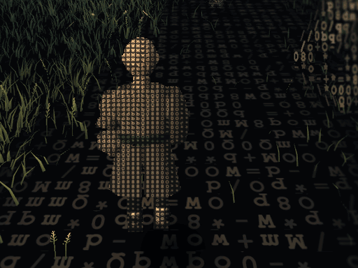
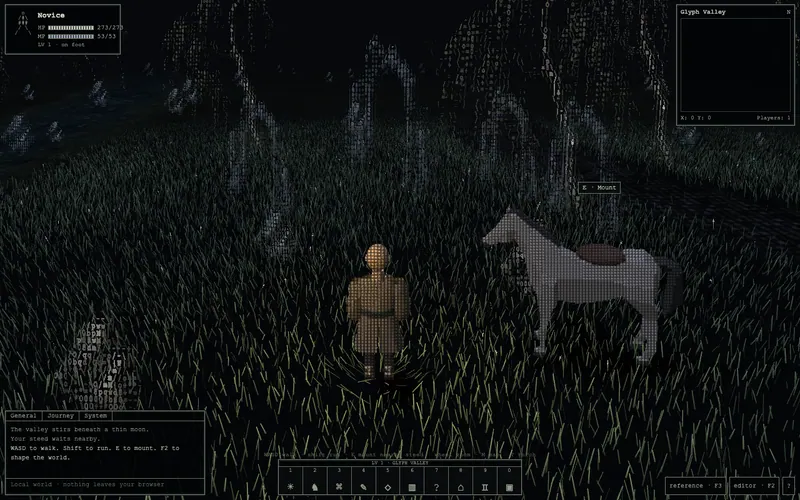
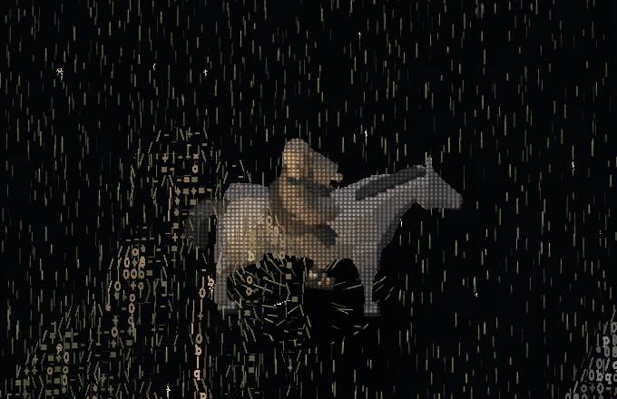
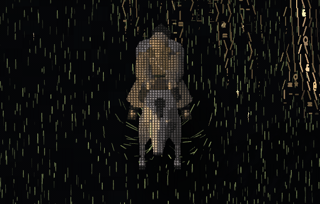
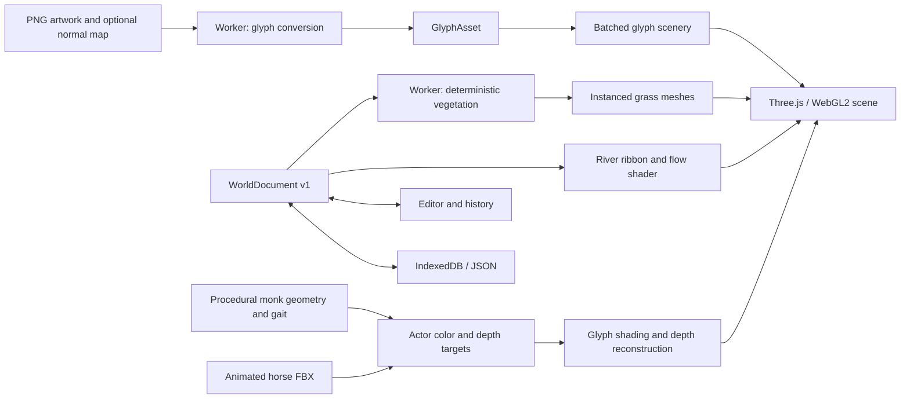

# ASCII Engine

A playable world made of letters, light, and moving grass. **ASCII Engine** is a TypeScript and WebGL2 experiment in rendering interactive scenery and animated 3D characters as glyphs. **Glyph Valley** is the included single-player demo, with a novice monk, a moonlit meadow, ruins, a horse, a trickling ASCII stream, and an in-browser world editor.



In play, the camera follows just behind the novice. Walk with **WASD**, hold **Shift** to run, and press **E** beside the horse to mount. The camera eases back on horseback. Use the wheel to adjust the distance or press **F2** for the overhead editor.

Built with **Three.js, custom GLSL shaders, Vite, and Web Workers**. Runs locally in a desktop browser. No account, API key, backend, or Blender installation is needed.

[Run locally](#run-locally) · [Screenshots](#screenshots) · [Features](#features) · [Controls](#controls) · [How it works](#how-it-works) · [Project layout](#project-layout)

## Screenshots

The walking, riding, water and editor animations are captures of the running game. The stills show the wider scene and controls at 1600 × 1000.

### Behind the monk



The camera follows at about 6.6 metres on foot and 10.2 metres on horseback at the default zoom. It eases around turns and leaves room to see the path ahead. The close-up gait recordings use the fixed overhead view to show the steps from the side.

### A continuous walk and gallop



Ride with **WASD** and hold **Shift** to gallop. The horse's upper and lower leg joints move together through a four-beat walk and a faster gallop. The novice leans into the gallop, rises and settles with the stride, and absorbs the motion through his knees and elbows. This close-up records actual movement through the meadow.

### Leaning into turns



Changing direction with **WASD** steers the horse through an arc. At a walk, the pair tip inward slightly; at a gallop, the horse takes a wider turn and the monk leans farther into it. His head stays steadier than his shoulders. Both settle upright as the path straightens or the horse stops.

### The valley


### A river of moving punctuation


### A map of the actual world


### Place props and paint the meadow


Open **F2**, choose an asset, and click to place it. The cursor ring marks each placement in the recording.


### Reshape the stream


### Bring your own artwork


Capture descriptions and player positions are recorded in [captures.json](docs/screenshots/captures.json).

## Run locally

Use **Node.js 22.12 or newer**, npm, and a desktop browser with WebGL2 and hardware acceleration. Development and browser checks have been performed on macOS with Chrome. Keyboard and mouse are the primary controls.

```sh
git clone https://github.com/nyllon-software/ascii-engine.git
cd ascii-engine
npm ci
npm run dev
```

Open the local URL printed by Vite, usually **http://127.0.0.1:5173/**. Keep the terminal running while playing. Initial startup converts the bundled scenery, constructs the novice monk, and loads the animated horse FBX.

```sh
npm test         # Run the unit tests
npm run build   # Type-check and build into dist/
npm run preview # Serve the production build locally
```

All runtime artwork and models are bundled. The build currently expects to be served at the root of a host because asset URLs start with `/`. A GitHub project Pages deployment would need base-path changes.

## Features

### Playable scene

- A seeded **256 × 256 meter** world with a hand-placed ruin area, scattered trees and rocks, a winding path, flowers, and a river.
- A **45° field-of-view perspective camera** looking about **19° downward** on foot. Mounting raises the viewpoint and increases the following distance. The editor and reference presets use the original **55° orthographic view** with independent zoom.
- A novice monk with a matte clay-colored robe, crossed linen collar, sash, shaved head, trousers, and sandals. The scene starts on foot with the horse nearby.
- Walking at **1.75 m/s**, running at **4.3 m/s**, mounted walking at **1.1 m/s**, and galloping at **8 m/s**, with calm idle and distinct locomotion states. Alternating footfalls, opposing arm swings, and split robe panels make each step visible.
- Mounting within reach of the horse and collision-checked dismount positions. The horse waits at its last position and heading while the novice walks away.
- Mounted steering follows the horse's heading. Turn speed and actual travel set how far the horse and monk bank, including when the player reverses direction.
- Basic circular prop collision, river collision, and world boundaries.
- A toggleable warm torch, moonlight, wind, haze, and configurable stylized sky reflection.
- A compact monospace HUD, local activity log, minimap, clickable hotbar, and nearby mount prompt.
- A world map with pan, zoom, named landmarks, player tracking, a parked-horse marker, and edits reflected from the current document.

### Rendering

- Object-local glyph grids for trees, rocks, ruin fragments, and flowers, using color, alpha, normals, and a shared glyph atlas.
- Animated 3D actors captured into their own color and depth targets, then reconstructed as fine glyph surfaces in the world.
- A combined mounted capture for rider/horse overlap, plus a separate capture for the parked horse.
- Zoom-aware actor glyph size, silhouette-preserving shading, and reconstructed per-pixel depth for world occlusion.
- Instanced narrow grass blades with deterministic placement, varied height and color, GPU wind, and displacement around the player.
- Chunk loading around the camera, worker-generated blade buffers, and disposal of distant chunks.
- A terrain-following river ribbon with moving `~`, commas, dashes, dots, and curved marks. Currents follow bends and move more slowly near shore.
- Soft, irregular wet banks, vegetation thinning into the shallows, subtle water highlights, and simple projected actor/prop shadows.

### Live authoring

- Place props from a palette, select by their base, drag, rotate, scale, duplicate, and delete.
- Optional **0.5 m** placement snapping.
- Grass and flower brushes with size, density, color, softness, planting, erasing, and restyling controls. Grass restyling preserves blade positions.
- One paint gesture creates one undo step. History retains up to **60** snapshots and supports redo.
- Edit river control-point coordinates, add/remove points, and change width.
- Tune wind, moonlight, haze, torch color, and sky-reflection mode while viewing the scene.
- Fly the editor camera, return to following the player, or move the player to clear ground at the camera target.
- Paint operations regenerate affected vegetation chunks. River changes regenerate the water ribbon and resident vegetation.

### Artwork and persistence

- Import a transparent **PNG** and optionally a matching normal map.
- Preview conversion with adjustable grid width, glyph density, normal strength, palette, name, and world height.
- Choose original colors, a moonlit palette, or grayscale. Transparency is preserved, and absent normals are approximated from image luminance gradients.
- Add converted artwork to the prop palette and place it immediately.
- Save explicitly to **IndexedDB**, load the saved world, or download/upload a versioned JSON world document.
- Custom PNG images, glyph grids, normals, prop placement, brush recipes, river geometry, lighting, and player/horse state travel together in the exported document. Built-in asset IDs resolve against the bundled library.
- Import validation runs before replacing the current world. Unsupported versions and malformed documents are rejected. The file picker limits imports to **50 MB**.

### Development tools

- Five camera/actor/time/UI presets covering the opening, a mounted close-up, the map, the riverbank, and the editor.
- Side-by-side reference viewing and an adjustable-opacity overlay.
- Simulation freeze, scene PNG capture, and a 30-second frame-time readout.
- Diagnostics for frame intervals, resident chunks/blades, cumulative blade generation, draw calls, triangles, animation clips, and render-buffer size.
- A small `window.__glyphValley` development interface for scene inspection, preset selection, freeze, world import/export, undo/redo, and statistics.

## Controls

| Action | Input |
| --- | --- |
| Walk / ride | `W A S D`, relative to the camera when you choose a direction |
| Run / gallop | Hold `Shift` |
| Mount / dismount | `E`, horse hotbar button, or nearby mount prompt |
| Toggle torch | `T` |
| Zoom camera | Mouse wheel |
| World map | `M` |
| Scene editor | `F2` |
| Reference comparison | `F3` |
| Save world locally | `Cmd/Ctrl + S` or Save |
| Undo / redo | `Cmd/Ctrl + Z` / `Cmd/Ctrl + Shift + Z` |
| Select / place / paint / drag | Left mouse button in the editor |
| Switch grass brush / selection | `B` in the editor |
| Rotate selected prop by 15° | `R` in the editor |
| Duplicate / delete selected prop | `Cmd/Ctrl + D` / `Delete` or `Backspace` |
| Move editor camera | `W A S D`, hold `Shift` for faster movement |
| Pan / zoom map | Drag / mouse wheel |
| Reset map view | Double-click |
| Close map/comparison or return to selection | `Escape` |

The numbered hotbar slots are clickable buttons. Additional buttons return to the opening shot, pause simulation time, save a scene image, and show help. Typing in editor fields suppresses movement. On keyboards with media keys, function shortcuts may require `Fn`.

## How it works



### Scenery glyphs

The renderer creates a **512 × 512** canvas atlas arranged as **8 × 8** glyph slots. The artwork converter samples the requested image grid, chooses glyph density from luminance, and favors directional marks such as `/`, `\\`, `|`, and `-` near edges. Every cell stores a glyph index, RGB color, alpha, and a unit normal.

Placed assets expand into a shared instanced glyph mesh. Each prop keeps a world-space anchor and a local grid. The shader orients its grid and normals to the active camera. In the chase view, foreground cells fade around the monk’s silhouette when a tree or ruin passes between him and the camera.

### Actor capture and depth

The novice monk is original articulated Three.js geometry built in [src/monk.ts](src/monk.ts). Matte cloth materials, a crossed linen collar, an offset sash, a small robe patch, a shaved head, trousers, and sandals create a simple trainee silhouette. The lower robe is split into two animated panels that follow the legs and widen for riding.

[src/monk-gait.ts](src/monk-gait.ts) samples deterministic foot targets for a **0.72-second walk cycle** and a **0.62-second run cycle**. The planted foot travels backward relative to the body at the player's forward speed. A two-link inverse-kinematics calculation positions each knee between the hip and ankle target. Opposing arms, subtle torso motion, cloth sway, and smooth transitions complete the pose. Idle uses slow breathing; riding brings the legs apart and the hands forward.

[src/rider-motion.ts](src/rider-motion.ts) drives mounted poses from the horse’s actual walk/run phases and animation blend weights. Walking adds a gentle sway. Galloping brings an approximately **18° forward lean**, **2.5–7.5 cm** of relative seat movement, pelvic rocking, partial head stabilization, and robe motion. The seat rises as the saddle drops to soften its vertical movement. Hands and feet keep targets relative to the saddle while two-link arm and leg solves let the elbows and knees yield. Pausing freezes the entire pose; stopping, dismounting, and reference resets clear the riding offsets.

The horse retains its Quaternius FBX model, normalized to approximately **1.9 m** in height. Three.js `FBXLoader` and `AnimationMixer` drive its idle, walk, and run clips. When mounted, the monk's hips follow the horse's animated saddle position. The previous knight and equipment files remain in the repository with their provenance, but the runtime no longer loads them.

[src/horse-animation.ts](src/horse-animation.ts) removes the source Walk clip's stationary second half. [src/horse-walk.ts](src/horse-walk.ts) retimes its hoof trajectories to a four-beat **left hind → left front → right hind → right front** sequence, with approximately **63–64% stance** and at least two supporting hooves. The **1.333-second** clip plays at **1.4×**, giving a relaxed **0.95-second** stride at **1.1 m/s**. The **0.833-second** Run clip plays at **1.65×** for galloping.

The source FBX moves independent hoof controls without sufficiently animating the leg chains above them. [src/horse-limbs.ts](src/horse-limbs.ts) reconstructs those constraints with two-link inverse kinematics, preserving segment lengths and distinct fore/hind bend directions. Corrected tracks are baked at **60 Hz** during loading. Four attachment corrections keep the separately weighted hooves on the legs during gait crossfades.

[src/mounted-steering.ts](src/mounted-steering.ts) moves the mount along its changing heading. Its signed turn rate and actual travel speed drive a bank capped at **18°**. The horse, saddle and monk share the roll; the monk adds a small shoulder lean and partly counter-rotates his head. During a bank, the renderer adjusts the legs so planted hooves keep their original gait position and orientation while lifted hooves follow the tilt. [Horse motion research and rig notes](docs/horse-motion.md) explain the measurements and limits.

Gait changes preserve cycle phase and crossfade over 0.14 seconds. Pausing preserves the current stride, and an unmounted horse returns to idle. The bundled FBX is retained unchanged.

The rider or combined mounted actor renders into a **512 × 640** color/depth target. A parked horse uses a **384 × 512** target. The glyph fragment shader samples those targets, adapts cell size to zoom, and retains a faint body surface underneath the glyph ink so thin parts stay visible. Explicit atlas gradients avoid disappearing glyphs at mip boundaries.

Source depth is unprojected through the capture camera and projected through the world camera into `gl_FragDepth`. The resulting actor surface can overlap correctly with scenery and grass. Color conversion is handled explicitly for these custom materials.

In the perspective view each actor target uses a crop of the main camera’s frustum. The monk and parked horse keep separate projection and depth transforms, so both still line up with the ground when they appear on opposite sides of the screen.

### Deterministic vegetation

The world is partitioned into **16 m chunks**. A globally indexed **0.10 m lattice**, seeded hashes, terrain/road/river masks, and ordered brush strokes determine each blade. Neighboring chunks share the same coordinate rules, preventing duplicate boundary blades. Grass heights currently range from roughly **0.09–0.26 m**.

Each blade uses nine floats for position, height, angle, phase, color, and flower state. The worker transfers the generated buffer back to the renderer. A chunk accepts only its latest pending request. Wind and player interaction bend blades at their grounded roots.

In play, individual blades gradually lose height, width, and contrast from roughly **16 to 42 m**. The renderer preloads another **12 m** in every direction so new ground is ready when the horse turns. Distant soil and scenery blend into the night sky, and grass also tapers at the physical map boundary. The overhead editor keeps full blade detail at the brush.

### ASCII stream

The river is an editable polyline with short quadratic curve sections rounding its bends. Ribbon UVs record distance across the river and cumulative distance downstream. Two layers of glyph lanes advect through those coordinates, with slight meandering, clustered marks, and a slower current near the banks.

The water mesh follows the shallow terrain. Noisy opacity and a subdued silt color blend the bank into the stream, while grass density falls smoothly through the wet margin. The underlying ground remains continuous beneath translucent edges. Sky reflection and highlights are stylized shader effects. Gameplay collision uses the source polyline.

### World documents and workers

The core interfaces are defined in [src/types.ts](src/types.ts).

| Interface | Contents |
| --- | --- |
| `GlyphAsset` | Source PNG data, optional normal-map source, grid dimensions, glyph/RGB/alpha/normal arrays, pivot, collision footprint, and world height |
| `WorldDocument` v1 | Seed, fixed world size, props, brush strokes, river points/width, lighting, player/horse state, and custom assets |
| `ReferenceShot` | Preset ID, reference timestamp, camera target/span, actor position/heading/mounted state, simulation time, and UI mode |

Vegetation is regenerated from the document's recipe instead of serialized blade-by-blade. IndexedDB stores one explicit local save. Refreshing starts the default scene until **Load saved** is selected. Undo/redo history is session-local. Custom asset conversion and vegetation generation run off the main thread through the same worker dispatcher.

## Reference views and diagnostics

Open a preset directly with a URL such as `http://127.0.0.1:5173/?shot=closeup&freeze=1&benchmark=1`.

| Preset | View |
| --- | --- |
| `opening` | Ruins and meadow |
| `closeup` | Mounted rider and fine glyph detail |
| `map` | Full symbol map |
| `riverbank` | On-foot riverbank view |
| `editor` | Nature editor |

`freeze=1` pauses simulation. `benchmark=1` fixes device pixel ratio to 1. Normal rendering caps device pixel ratio at 1.5. Presets restore camera, actor, time, and UI state, while retaining the current world's edits and lighting. Reload for the default seed and authoring state.

The **F3** panel can compare the live renderer with the supplied study frames at 0, 5, 14, 23, and 37 seconds. The source video is 2304 × 1440. These are visual calibration aids, not scenery textures.

Performance counters need context. `visibleBlades` counts resident vegetation, including camera-margin chunks. `generatedBlades` is cumulative work and includes regenerated chunks, so it is not a unique world population count. Draw-call statistics cover the main scene pass. Frame-time figures measure frame intervals, not isolated GPU time.

## Tests and current scope

The **68 unit tests** cover deterministic vegetation, chunk boundaries, erase/restyle behavior, brush coverage, undo/redo, JSON round trips, validation, converter transparency and normals, frozen poses, collision, dismount placement, horse heading, and compatibility with older saves. Monk gait tests check footfalls, planted-foot travel, walking support and running flight. Horse tests load the actual FBX to check contact order, segment lengths, gait transitions, grounded hooves during either bank, and preservation of the source model. Rider tests check gait blending, seat movement against the animated saddle, hand/foot targets, and head and shoulder response in a turn. Steering tests cover curved travel, speed-dependent bank, frame-rate stability, reversals through the angle wrap, and blocked movement. Camera tests exercise mount easing, camera-relative input, off-centre actor depth, and grass preload coverage.

Browser checks have exercised movement, riding transitions, actor visibility across headings/zoom levels, river editing and undo, reflection controls, and artwork preview. The mounted-turn capture uses real keyboard input; browser checks also cover a galloping U-turn, pausing mid-bank, and dismount/remount without a leftover tilt. The chase-camera check also covers mounting, galloping, dismounting, F2 editing, map/reference transitions and crossing grass chunk boundaries. Removing fully faded preload chunks produced an identical rendered frame. A complete automated browser import/export regression suite is still outstanding.

A 30-second production run on an **Apple M5 Max**, using Chrome 156 with Metal at **2304 × 1440** and device pixel ratio 1, measured **16.7 ms median and 16.7 ms p95** over 1,801 frame intervals after warm-up. The route covered 203 m of walking and riding.

This is an experimental renderer and playable scene, with no stable engine SDK yet. Multiplayer, combat, progression, trading, desktop packaging, and sketch-driven world generation are outside this build. HP, MP, and level displays are decorative. Some visual effects use deliberate approximations, including projected shadows, billboard scenery, shallow terrain, and procedural reflection. Exact visual matching to the inspiration footage has not been certified.

## Project layout

```text
src/
  main.ts                    UI, input, editor, imports and application lifecycle
  renderer.ts                World rendering, glyph atlas, camera and chunk lifecycle
  chase-camera.ts            Trailing perspective, mounted framing, input and actor frusta
  actors.ts                  Monk/horse coordination, horse FBX animation and capture targets
  horse-animation.ts         Continuous horse clips and coordinated gait/speed settings
  horse-walk.ts              Four-beat contact timing and grounded stance
  horse-limbs.ts             Baked leg motion and hoof support during banks
  mounted-steering.ts        Curved travel, turning rate and inward bank
  rider-motion.ts            Horse-synchronized seat, torso, head and cloth response
  monk.ts                    Articulated novice, robe panels, limb IK and pose transitions
  monk-gait.ts               Deterministic idle, walk, run and riding foot/body targets
  actor-surface.frag.glsl     Actor glyph shading and depth reconstruction
  shaders.ts                 Scenery and grass shaders
  stream.ts                  River ribbon geometry and material setup
  stream.frag.glsl           Moving punctuation, wet margins and water lighting
  converter.ts               Artwork-to-glyph conversion and approximate normals
  jobs.ts / worker.ts        Worker dispatch and transferable generation results
  world.ts                   Seeded world, vegetation, collision, presets and history
  map.ts                     World map and minimap
  storage.ts                 IndexedDB and JSON downloads
  types.ts                   Asset, world, stroke and preset interfaces
  style.css                  Monospace HUD and editor presentation
public/
  art/                       Transparent scenery PNGs and generation provenance
  models/                    Horse FBX, archived prototype assets, source credits and manifest
  references/                Reference study frames and provenance
docs/screenshots/            Current app captures and animated stream
tests/                      World, conversion, history and riding tests
```

## Credits and provenance

- Visual inspiration and reference study material come from **[Ansenjeo](https://x.com/Ansenjeo)**. This is an independent implementation based on footage and public descriptions. The original game's source code is not part of this repository.
- The novice monk geometry and procedural gait are original to this project.
- The horse and the retained, unused knight/equipment prototype assets are by **[Quaternius](https://quaternius.com/)**, distributed under **CC0 1.0**. [Model sources](public/models/SOURCES.md) and the [asset manifest](public/models/manifest.json) record pack links, checksums, dimensions, and animations.
- The transparent scenery artwork was generated specifically for this project. [Prompts and process](public/art/PROMPTS.md) document the source art used by the same importer available in the editor.
- The included study frames are identified separately in [reference provenance](public/references/README.md). They are not screenshots of ASCII Engine.

No project-wide source-code license has been selected. Third-party assets retain their respective terms.
