# ASCII Engine

A playable world made of letters, light, and moving grass. **ASCII Engine** is a TypeScript and WebGL2 experiment in rendering interactive scenery and animated 3D characters as glyphs. **Glyph Valley** is the included single-player demo, with a moonlit meadow, ruins, a horse, a trickling ASCII stream, and an in-browser world editor.

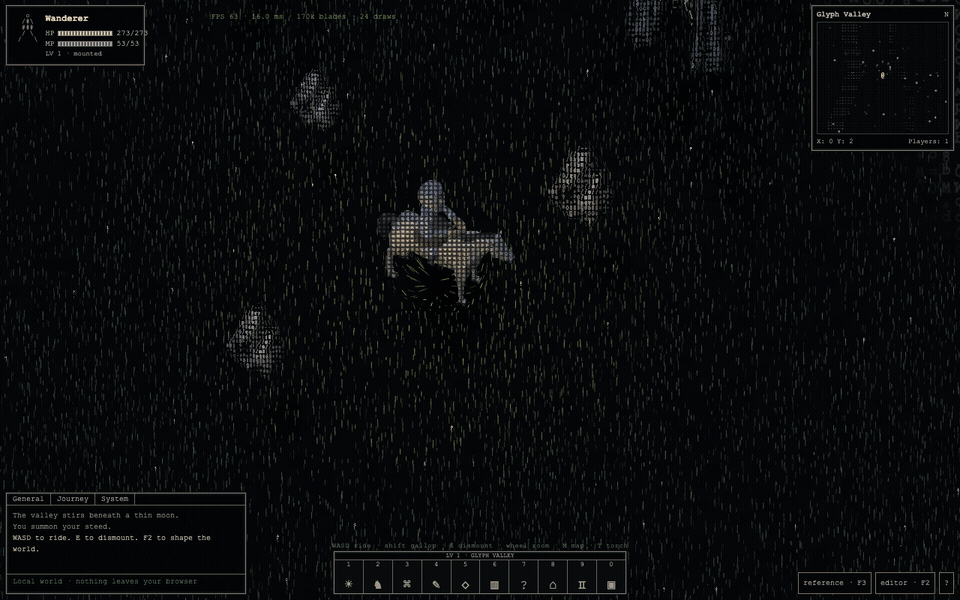

Dismount, hold **Shift + WASD**, and explore on foot. Your horse waits where you left it.

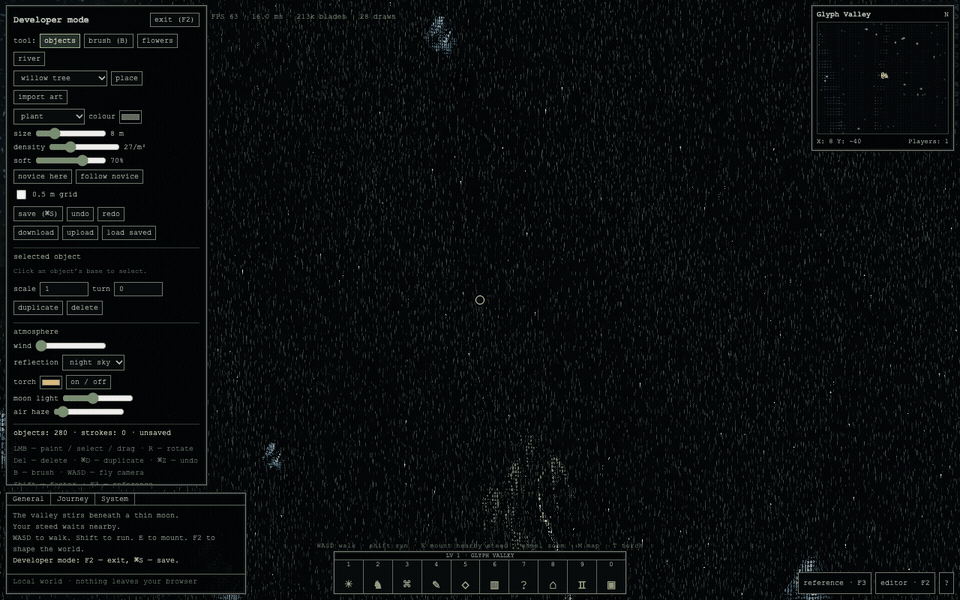

Open **F2**, choose an asset, and place it directly into the world. This recording adds a tree, a ruin fragment, two rocks, and flowers. The cursor ring highlights the clicks.

Built with **Three.js, custom GLSL shaders, Vite, and Web Workers**. Runs locally in a desktop browser. No account, API key, backend, or Blender installation is needed.

[Run locally](#run-locally) · [Screenshots](#screenshots) · [Features](#features) · [Controls](#controls) · [How it works](#how-it-works) · [Project layout](#project-layout)

## Screenshots

The still screenshots are captures of the running application at 1600 × 1000. The opening GIFs show actual keyboard movement and editor placement, recorded with a fixed camera and calm wind. The stream animation is a four-second crop from the running renderer. Click an image to inspect it at full size.

### The valley

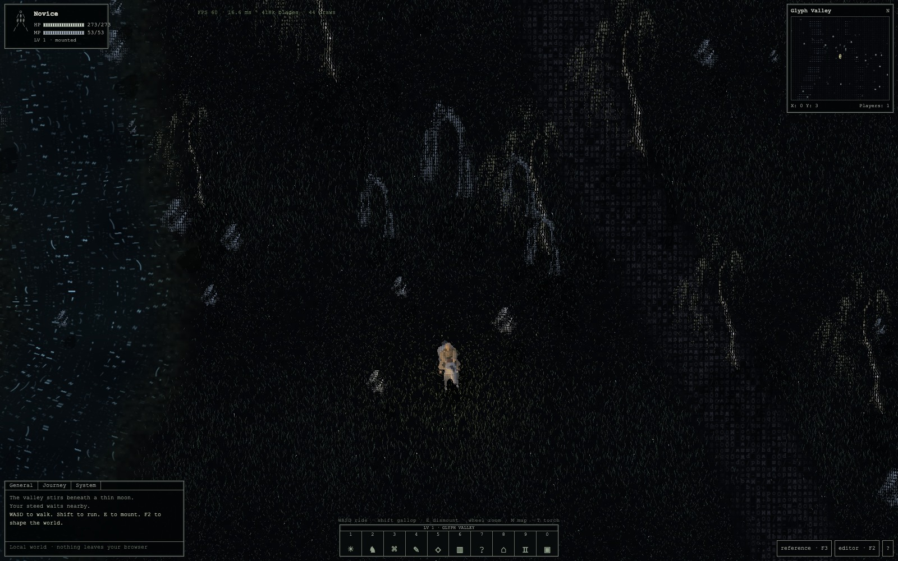

### Fine glyphs on animated characters

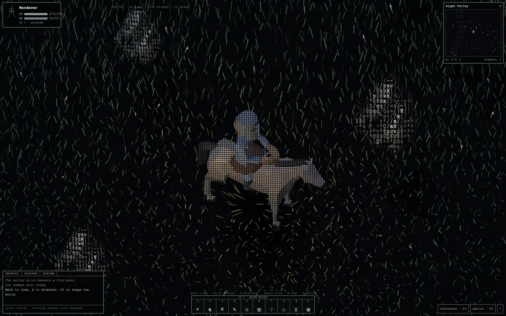

### Walking and a parked horse

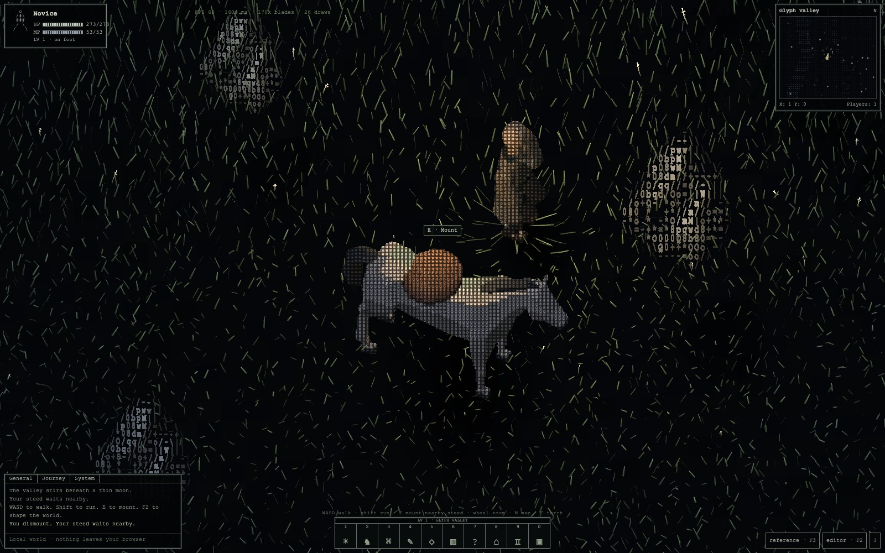

### A river of moving punctuation

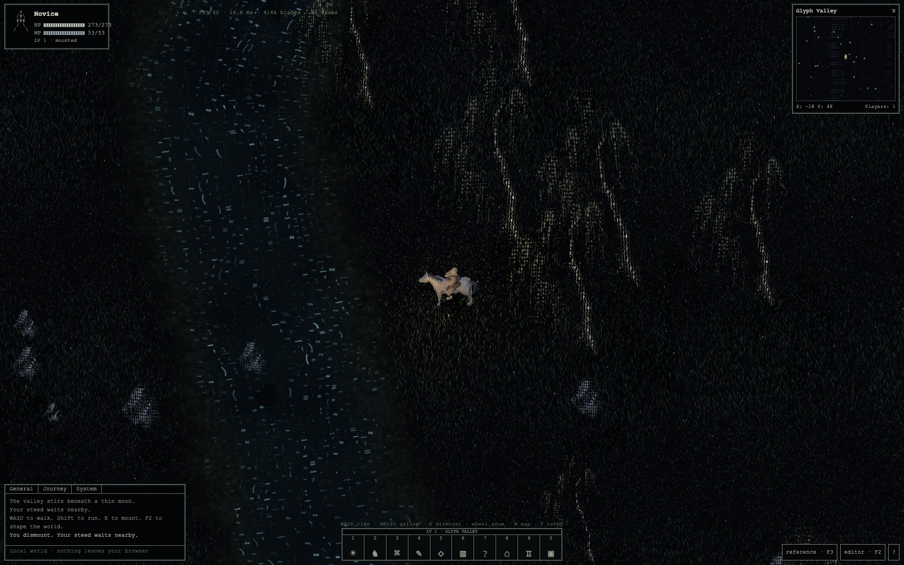

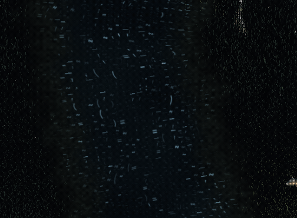

### A map of the actual world

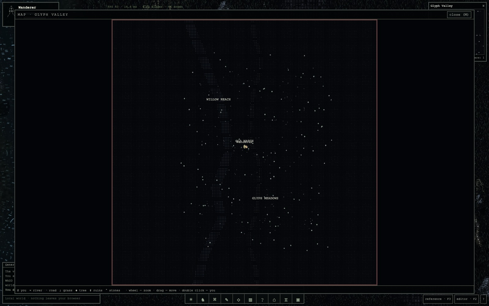

### Paint the meadow while the game is running

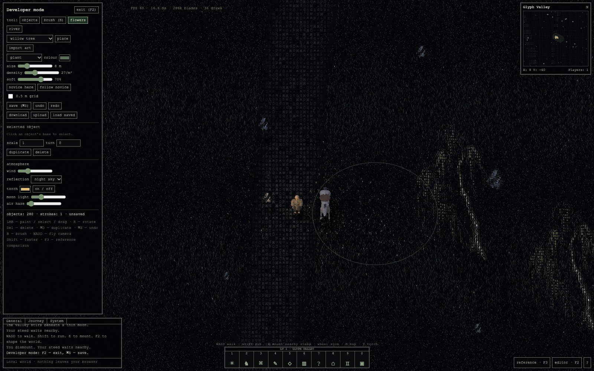

### Reshape the stream

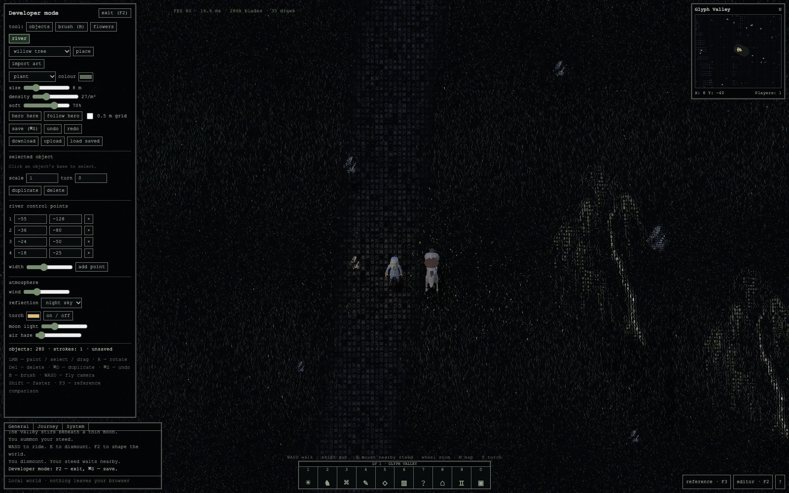

### Bring your own artwork

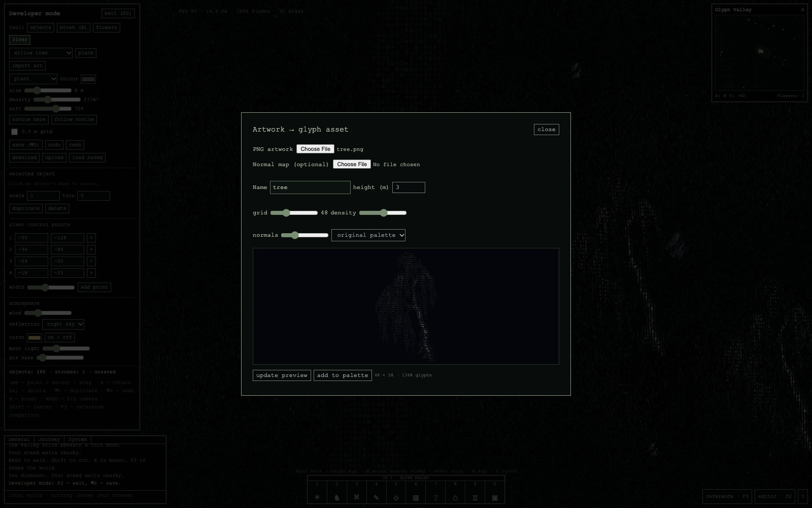

Capture descriptions and player positions are recorded in [captures.json](docs/screenshots/captures.json).

## Run locally

Use **Node.js 22.12 or newer**, npm, and a desktop browser with WebGL2 and hardware acceleration. Development and browser checks have been performed on macOS with Chrome. Keyboard and mouse are the primary controls.

```sh
git clone https://github.com/nyllon-software/ascii-engine.git
cd ascii-engine
npm ci
npm run dev
```

Open the local URL printed by Vite, usually **http://127.0.0.1:5173/**. Keep the terminal running while playing. Initial startup converts the bundled scenery and loads the animated FBX models.

```sh
npm test         # Run the unit tests
npm run build   # Type-check and build into dist/
npm run preview # Serve the production build locally
```

All runtime artwork and models are bundled. The build currently expects to be served at the root of a host because asset URLs start with `/`. A GitHub project Pages deployment would need base-path changes.

## Features

### Playable scene

- A seeded **256 × 256 meter** world with a hand-placed ruin area, scattered trees and rocks, a winding path, flowers, and a river.
- An orthographic camera pitched approximately **55° downward**, smooth player following, and mouse-wheel zoom.
- Walking, running, mounted travel, and galloping, with animated idle and locomotion states.
- Mounting within reach of the horse and collision-checked dismount positions. The horse waits at its last position and heading while the knight walks away.
- Basic circular prop collision, river collision, and world boundaries.
- A toggleable warm torch, moonlight, wind, haze, and configurable stylized sky reflection.
- A compact monospace HUD, local activity log, minimap, clickable hotbar, and nearby mount prompt.
- A world map with pan, zoom, named landmarks, player tracking, a parked-horse marker, and edits reflected from the current document.

### Rendering

- Object-local glyph grids for trees, rocks, ruin fragments, and flowers, using color, alpha, normals, and a shared glyph atlas.
- Animated 3D actors captured into their own color and depth targets, then reconstructed as fine glyph surfaces in the world.
- A combined mounted capture for rider/horse overlap, plus a separate capture for the parked horse.
- Zoom-aware actor glyph size, silhouette-preserving shading, and reconstructed per-pixel depth for world occlusion.
- Instanced narrow grass blades with deterministic placement, varied height and color, GPU wind, and displacement around the player.
- Chunk loading around the camera, worker-generated blade buffers, and disposal of distant chunks.
- A terrain-following river ribbon with moving `~`, commas, dashes, dots, and curved marks. Currents follow bends and move more slowly near shore.
- Soft, irregular wet banks, vegetation thinning into the shallows, subtle water highlights, and simple projected actor/prop shadows.

### Live authoring

- Place props from a palette, select by their base, drag, rotate, scale, duplicate, and delete.
- Optional **0.5 m** placement snapping.
- Grass and flower brushes with size, density, color, softness, planting, erasing, and restyling controls. Grass restyling preserves blade positions.
- One paint gesture creates one undo step. History retains up to **60** snapshots and supports redo.
- Edit river control-point coordinates, add/remove points, and change width.
- Tune wind, moonlight, haze, torch color, and sky-reflection mode while viewing the scene.
- Fly the editor camera, return to following the player, or move the player to clear ground at the camera target.
- Paint operations regenerate affected vegetation chunks. River changes regenerate the water ribbon and resident vegetation.

### Artwork and persistence

- Import a transparent **PNG** and optionally a matching normal map.
- Preview conversion with adjustable grid width, glyph density, normal strength, palette, name, and world height.
- Choose original colors, a moonlit palette, or grayscale. Transparency is preserved, and absent normals are approximated from image luminance gradients.
- Add converted artwork to the prop palette and place it immediately.
- Save explicitly to **IndexedDB**, load the saved world, or download/upload a versioned JSON world document.
- Custom PNG images, glyph grids, normals, prop placement, brush recipes, river geometry, lighting, and player/horse state travel together in the exported document. Built-in asset IDs resolve against the bundled library.
- Import validation runs before replacing the current world. Unsupported versions and malformed documents are rejected. The file picker limits imports to **50 MB**.

### Development tools

- Five camera/actor/time/UI presets covering the opening, a mounted close-up, the map, the riverbank, and the editor.
- Side-by-side reference viewing and an adjustable-opacity overlay.
- Simulation freeze, scene PNG capture, and a 30-second frame-time readout.
- Diagnostics for frame intervals, resident chunks/blades, cumulative blade generation, draw calls, triangles, animation clips, and render-buffer size.
- A small `window.__glyphValley` development interface for scene inspection, preset selection, freeze, world import/export, undo/redo, and statistics.

## Controls

| Action | Input |
| --- | --- |
| Walk / ride | `W A S D` |
| Run / gallop | Hold `Shift` |
| Mount / dismount | `E`, horse hotbar button, or nearby mount prompt |
| Toggle torch | `T` |
| Zoom camera | Mouse wheel |
| World map | `M` |
| Scene editor | `F2` |
| Reference comparison | `F3` |
| Save world locally | `Cmd/Ctrl + S` or Save |
| Undo / redo | `Cmd/Ctrl + Z` / `Cmd/Ctrl + Shift + Z` |
| Select / place / paint / drag | Left mouse button in the editor |
| Switch grass brush / selection | `B` in the editor |
| Rotate selected prop by 15° | `R` in the editor |
| Duplicate / delete selected prop | `Cmd/Ctrl + D` / `Delete` or `Backspace` |
| Move editor camera | `W A S D`, hold `Shift` for faster movement |
| Pan / zoom map | Drag / mouse wheel |
| Reset map view | Double-click |
| Close map/comparison or return to selection | `Escape` |

The numbered hotbar slots are clickable buttons. Additional buttons return to the opening shot, pause simulation time, save a scene image, and show help. Typing in editor fields suppresses movement. On keyboards with media keys, function shortcuts may require `Fn`.

## How it works

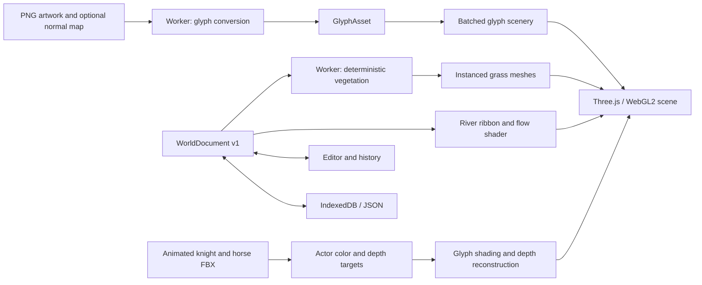

### Scenery glyphs

The renderer creates a **512 × 512** canvas atlas arranged as **8 × 8** glyph slots. The artwork converter samples the requested image grid, chooses glyph density from luminance, and favors directional marks such as `/`, `\\`, `|`, and `-` near edges. Every cell stores a glyph index, RGB color, alpha, and a unit normal.

Placed assets expand into a shared instanced glyph mesh. Their cell positions derive from the asset pivot and world transform, so the grid stays attached to the object as the camera moves. Cutout fragments participate in depth testing. Normal-based lighting and wind deformation are evaluated in the custom scenery shader.

### Actor capture and depth

Three.js `FBXLoader` loads the Quaternius knight and horse. Models are normalized to approximately **1.82 m** and **1.9 m** in height. `AnimationMixer` drives idle, walking, and running. A generated seated clip adapts the knight's rig to riding, and its hips follow the animated horse's saddle position. The helmet is attached to the knight.

The rider or combined mounted actor renders into a **512 × 640** color/depth target. A parked horse uses a **384 × 512** target. The glyph fragment shader samples those targets, adapts cell size to zoom, and retains a faint body surface underneath the glyph ink so thin parts stay visible. Explicit atlas gradients avoid disappearing glyphs at mip boundaries.

Source depth is unprojected through the capture camera and projected through the world camera into `gl_FragDepth`. The resulting actor surface can overlap correctly with scenery and grass. Color conversion is handled explicitly for these custom materials.

### Deterministic vegetation

The world is partitioned into **16 m chunks**. A globally indexed **0.10 m lattice**, seeded hashes, terrain/road/river masks, and ordered brush strokes determine each blade. Neighboring chunks share the same coordinate rules, preventing duplicate boundary blades. Grass heights currently range from roughly **0.09–0.26 m**.

Each blade uses nine floats for position, height, angle, phase, color, and flower state. The worker transfers the generated typed-array buffer back to the renderer. Per-chunk generation counters and a world epoch prevent stale asynchronous results from replacing newer edits. Vertex shaders animate wind and nearby-player bending while keeping roots grounded.

### ASCII stream

The river is an editable polyline with short quadratic curve sections rounding its bends. Ribbon UVs record distance across the river and cumulative distance downstream. Two layers of glyph lanes advect through those coordinates, with slight meandering, clustered marks, and a slower current near the banks.

The water mesh follows the shallow terrain. Noisy opacity and a subdued silt color blend the bank into the stream, while grass density falls smoothly through the wet margin. The underlying ground remains continuous beneath translucent edges. Sky reflection and highlights are stylized shader effects. Gameplay collision uses the source polyline.

### World documents and workers

The core interfaces are defined in [src/types.ts](src/types.ts).

| Interface | Contents |
| --- | --- |
| `GlyphAsset` | Source PNG data, optional normal-map source, grid dimensions, glyph/RGB/alpha/normal arrays, pivot, collision footprint, and world height |
| `WorldDocument` v1 | Seed, fixed world size, props, brush strokes, river points/width, lighting, player/horse state, and custom assets |
| `ReferenceShot` | Preset ID, reference timestamp, camera target/span, actor position/heading/mounted state, simulation time, and UI mode |

Vegetation is regenerated from the document's recipe instead of serialized blade-by-blade. IndexedDB stores one explicit local save. Refreshing starts the default scene until **Load saved** is selected. Undo/redo history is session-local. Custom asset conversion and vegetation generation run off the main thread through the same worker dispatcher.

## Reference views and diagnostics

Open a preset directly with a URL such as `http://127.0.0.1:5173/?shot=closeup&freeze=1&benchmark=1`.

| Preset | View |
| --- | --- |
| `opening` | Ruins and meadow |
| `closeup` | Mounted rider and fine glyph detail |
| `map` | Full symbol map |
| `riverbank` | On-foot riverbank view |
| `editor` | Nature editor |

`freeze=1` pauses simulation. `benchmark=1` fixes device pixel ratio to 1. Normal rendering caps device pixel ratio at 1.5. Presets restore camera, actor, time, and UI state, while retaining the current world's edits and lighting. Reload for the default seed and authoring state.

The **F3** panel can compare the live renderer with the supplied study frames at 0, 5, 14, 23, and 37 seconds. The source video is 2304 × 1440. These are visual calibration aids, not scenery textures.

Performance counters need context. `visibleBlades` counts resident vegetation, including camera-margin chunks. `generatedBlades` is cumulative work and includes regenerated chunks, so it is not a unique world population count. Draw-call statistics cover the main scene pass. Frame-time figures measure frame intervals, not isolated GPU time.

## Tests and current scope

The **19 unit tests** cover deterministic vegetation, chunk boundaries, erase/restyle behavior, brush coverage, undo/redo, JSON round trips, validation, converter transparency and normals, collision, dismount placement, horse heading, and compatibility with older saves.

Browser checks have exercised movement, riding transitions, actor visibility across headings/zoom levels, river editing and undo, reflection controls, and artwork preview. The README screenshots show the current implementation. A complete automated browser import/export regression suite and the fixed **2304 × 1440** performance acceptance run are still outstanding.

This is an experimental renderer and playable scene, with no stable engine SDK yet. Multiplayer, combat, progression, trading, desktop packaging, and sketch-driven world generation are outside this build. HP, MP, and level displays are decorative. Some visual effects use deliberate approximations, including projected shadows, billboard scenery, shallow terrain, and procedural reflection. Exact visual matching to the inspiration footage has not been certified.

## Project layout

```text
src/
  main.ts                    UI, input, editor, imports and application lifecycle
  renderer.ts                World rendering, glyph atlas, camera and chunk lifecycle
  actors.ts                  FBX animation, seated pose, equipment and capture targets
  actor-surface.frag.glsl     Actor glyph shading and depth reconstruction
  shaders.ts                 Scenery and grass shaders
  stream.ts                  River ribbon geometry and material setup
  stream.frag.glsl           Moving punctuation, wet margins and water lighting
  converter.ts               Artwork-to-glyph conversion and approximate normals
  jobs.ts / worker.ts        Worker dispatch and transferable generation results
  world.ts                   Seeded world, vegetation, collision, presets and history
  map.ts                     World map and minimap
  storage.ts                 IndexedDB and JSON downloads
  types.ts                   Asset, world, stroke and preset interfaces
  style.css                  Monospace HUD and editor presentation
public/
  art/                       Transparent scenery PNGs and generation provenance
  models/                    Animated FBX assets, source credits and manifest
  references/                Reference study frames and provenance
docs/screenshots/            Current app captures and animated stream
tests/                      World, conversion, history and riding tests
```

## Credits and provenance

- Visual inspiration and reference study material come from **[Ansenjeo](https://x.com/Ansenjeo)**. This is an independent implementation based on footage and public descriptions. The original game's source code is not part of this repository.
- Knight, horse, and equipment assets are by **[Quaternius](https://quaternius.com/)**, distributed under **CC0 1.0**. [Model sources](public/models/SOURCES.md) and the [asset manifest](public/models/manifest.json) record pack links, checksums, dimensions, and animations.
- The transparent scenery artwork was generated specifically for this project. [Prompts and process](public/art/PROMPTS.md) document the source art used by the same importer available in the editor.
- The included study frames are identified separately in [reference provenance](public/references/README.md). They are not screenshots of ASCII Engine.

No project-wide source-code license has been selected. Third-party assets retain their respective terms.
